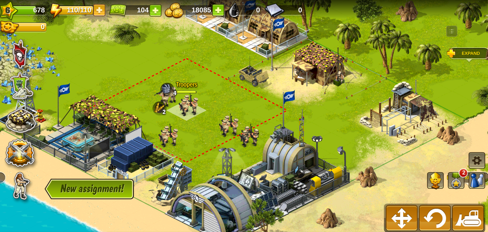

# Warzone / Линия Огня

Unofficial Rust recreation of Playkot's Warzone for iOS.

No emulator or ARM code. No server logic.

What changed compared to original IOS version:
1. All server logic was moved to client itself, all saves are stored on your device
2. All game parts which used server logic (PvP/Facebook/Forum/etc) are disabled using stubs
3. You can replay missions now
4. Overall usability was improved (zoom in/out, hotkeys, different resolution)
5. Free banknote offers were added to shop for tests
6. Remove small bugs



## Сборка и запуск

To compile you need original **Warzone 1.11.2 IPA**. Put it next to `Cargo.toml` using the `warzone.ipa` name. Checksums are included in `tools/assets.json`.

Linux requirements: recent stable Rust (edition 2024), Python 3.11+, FFmpeg, SDL2 2.0.18+ (`libsdl2-dev`).

```bash
# Run the game
python3 -B run.py

# New game in a separate profile
python3 -B run.py --profile new-game

# Rerun without building
python3 -B run.py --no-build

# Set icon
python3 -B tools/install_desktop.py
```

The launcher builds `target/release/warzone-app-client` with release optimizations.

Saves are stored in `saves/<name>/`, new profile are created automatically.
Corrupted files are not removed automatically.

`tools/prepare.py` only extracts `Payload/warzone.app/data/` and root TTF from common IPA file, checks hashes and creates `assets/pack/`.

Audio converts using FFmpeg. Executable iOS file and sign-file are not migrated.

Geometry and local rules are stored in `tools/layout.json`.
Complete ambient animation graphs are compiled from the IPA into `assets/pack/ambient.json`.
Preparing an existing pack adds these timelines without changing its scene checksum or saved progress.
Open-source backup fonts with license are stored `third_party/fonts/`.

## Browser version and PWA

You need [Emscripten SDK](https://emscripten.org/docs/getting_started/downloads.html) and Rust target. Tested with Emscripten **7.0.0** and Rust **nightly-2026-06-11**. Web builds use size optimization and rebuild the standard library for the SDK ABI.

```bash
source /path/to/emsdk/emsdk_env.sh
rustup toolchain install nightly-2026-06-11 --component rust-src
rustup target add wasm32-unknown-emscripten --toolchain nightly-2026-06-11
WARZONE_WEB_TOOLCHAIN=nightly-2026-06-11 python3 -B tools/build.py --web
python3 -B tools/serve.py
```

Open `http://127.0.0.1:8080`.

PWA installation is already supported: use the install button/browser menu, or “Add to Home Screen” on iPhone. A phone needs HTTPS; localhost is sufficient on a computer. No app store is required.

After the first launch, let the complete offline cache finish downloading. The start page reports “Офлайн-режим готов” when it is ready. The game can then restart without internet. Progress is saved automatically in IndexedDB on your device; clearing site data removes it. Installation alone does not mean that the offline download has finished. [Offline operation](https://developer.mozilla.org/en-US/docs/Web/Progressive_web_apps/Guides/Offline_and_background_operation).

Fullscreen toggles on/off with the same button. Audio playback uses Web Audio independently of the UI thread. Common menu artwork/text is prepared during loading; browser touch input supports taps, drags and two-finger zoom.

The welcome page uses a high-quality static screenshot of the reconstructed base with centered controls. Optional local files are `web/branding/base-poster.jpg` and `favicon.ico`; these are excluded from Git. A clean checkout falls back to original IPA artwork. To capture a base in 3840×2160 without changing your source save, run the browser check below with `WARZONE_CAPTURE_BACKGROUND=1 WARZONE_WIDE=1 WARZONE_IMPORT_SAVE=saves/<name>/state.json`, then repackage the shell.

Loading rectangles, pivots and text sizes are read directly from the IPA's `progressscreen.json`; its original background, logo, studio mark, progress textures and fonts are extracted at build time. After changing only the web shell, run `python3 -B tools/build.py --web-shell-only`.

The welcome page supports portrait orientation. On phones, Start switches the loader and game surface to landscape. Supported browsers also receive a fullscreen/orientation-lock request; on iPhone, the surface rotates inside the page with matching touch coordinates because Safari does not support the lock API. Turning the phone to landscape removes this fallback. [Screen orientation restrictions](https://developer.mozilla.org/en-US/docs/Web/API/ScreenOrientation/lock).

The canvas uses up to 3× device-pixel density within a 3840×2160 buffer limit. HUD controls keep their size in CSS pixels; saved camera zoom is independent of pixel density. On phones the toolbar starts collapsed: tap its handle to show/hide controls, or drag the handle to move it. Position and visibility are saved locally and clamped to the safe area after rotation.

## Checks

```bash
python3 -m venv .venv
source .venv/bin/activate
pip install -r requirements-dev.txt
npm ci

# Python lint and formatting
ruff check .
ruff format --check .
# Apply formatting: ruff format .

# JavaScript, CSS and HTML lint/formatting with Biome
npm run check
# Apply formatting: npm run format

cargo fmt --all -- --check
cargo clippy --all-targets
cargo test --lib --tests
```

The original IPA is needed for checks too. Native checks cover wide layouts, hit testing, save rules and audio admission. The browser smoke check (`tools/browser_smoke.mjs`) requires Node 22+ and Chromium.

```bash
node tools/browser_smoke.mjs
```

`python3 -B tools/check.py --scripts-only` checks Python/web sources without an IPA. Development tools have pinned versions; JavaScript remains directly executable without a TypeScript compilation step.

To run checks and a release build sequentially with one Cargo job: `python3 -B tools/check.py --release`.

All changes are welcome, create a branch, open a PR and wait for review.
